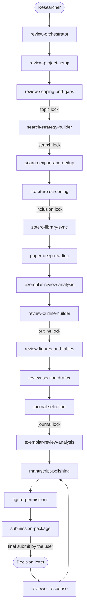

[中文](README.zh.md) / [English](README.md)

# literature-review-skills

An agent-agnostic skill suite that takes a researcher from a vague topic to a review manuscript and through revision, with every claim tied to a source the project actually holds. The skills encode public reporting practice (PRISMA 2020, PRISMA-S, Cochrane Handbook chapter 4, JBI scoping guidance, ICMJE, COPE) and the official workflows of PubMed, Web of Science, Scopus, Zotero, Unpaywall, Crossref, and RightsLink. The agent stops at human gates, and it does not invent citations.

This suite is for researchers writing a narrative, systematic, scoping, or umbrella review who want a repeatable folder layout and an agent that will not skip eligibility criteria, search reporting, or permissions.

## Features

- Seventeen skills, from project setup through a point-by-point reviewer response. `review-orchestrator` reads `project.yaml` and routes to the next one.
- Six human gates: topic, search strings, inclusion criteria, outline, journal, and final submit. The user passes a gate. The agent records it.
- An evidence table. Draft sentences map to evidence ids or stay marked `[NEEDS SOURCE]`.
- A tested deduplicator (`DOI`, then `PMID`, then normalized title and year) that writes PRISMA identification counts from RIS, PubMed NBIB, and CSV exports.
- An identifier checker (`skills/search-export-and-dedup/scripts/verify_ids.py`) that resolves DOIs (Digital Object Identifier strings usually starting with 10. that name papers) via Crossref (a DOI registration agency) and PMIDs (PubMed numeric ids) via NCBI (the US National Center for Biotechnology Information), writing flagged results (`[VERIFY]`) to `identifier_check.csv` without modifying the input file.
- Original figures by default, drawn as an editable SVG plus a PDF. Reused or adapted items are logged for permission instead of being copied or cropped.
- A narrative review can keep a user-confirmed core and log the rest as not read. Systematic, scoping, and umbrella reviews still screen every deduplicated record.
- Outlines keep limitations and next questions as separate sections. After journal lock, the style brief is refreshed and polishing follows its heading pattern, abstract shape, and figure budget.
- English project files, templates, and agent-written outputs.

## Workflow

Folder numbers are storage slots. The order below is the order of the work. Journal lock comes before polishing so the manuscript can follow that journal's instructions. `figure-permissions` can start as soon as the figure ledger has an adapted or reused item; submission waits until those items are cleared.



## Skills

| # | Skill | Purpose |
|---|-------|---------|
| 0 | `review-orchestrator` | Entry point. Reads `project.yaml` and `LOG.md`, reports the current stage, routes to the next skill, and enforces gates. |
| 1 | `review-project-setup` | Create the layout, interview the user (topic, field, review type, audience, timeline), and write `project.yaml`. |
| 2 | `review-scoping-and-gaps` | Landscape scan, candidate angles, gap statements, feasibility counts, and one recommended angle. Gate: topic lock. Optional post-export clustering can ask to reopen that lock. |
| 3 | `search-strategy-builder` | PICO, PEO, or SPIDER concepts to synonyms, MeSH or Emtree, and field tags; PubMed, Web of Science, and Scopus strings; test-run counts; PRISMA-S block. Gate: search lock. Optional wide, middle, and tight strings when a hit count is extreme; one string stays locked. |
| 4 | `search-export-and-dedup` | Export the searches (browser if the user is driving it, otherwise RIS, NBIB, or CSV), merge and deduplicate, and write PRISMA identification counts. |
| 5 | `literature-screening` | Inclusion and exclusion criteria, title/abstract then full-text screening with reasons, optional Cohen's kappa, and PRISMA 2020 flow numbers. Narrative reviews instead keep a user-sized core and log the rest as not read. |
| 6 | `zotero-library-sync` | Import included records to Zotero, map collections, and record legal full-text retrieval. The user confirms a collection checklist. No shadow libraries and no desktop control. Optional note export only after they ask. |
| 7 | `paper-deep-reading` | Per-paper notes and evidence-table rows. Short quotes only, with page numbers. |
| 8 | `exemplar-review-analysis` | Read 3-5 recent reviews the user can open and write a style brief. After journal lock, refresh that brief from reviews in the locked journal. |
| 9 | `review-outline-builder` | Thematic outline with section claims, evidence ids, planned figures, and a word budget, including limitations and next questions. Systematic reviews also get a registration reminder and a bias-tool checklist. Gate: outline lock. |
| 10 | `review-figures-and-tables` | Plan an original Fig. 1 argument map, synthesis tables, and a ledger. Write an SVG and a PDF for each original item. |
| 11 | `review-section-drafter` | Draft one section at a time from the outline and the evidence table, with hedges matched to the evidence. A finished draft must include limitations and next questions. |
| 12 | `journal-selection` | Shortlist 3-5 journals from official pages (scope, review article types, invitation rules, OA and APC, turnaround, indexing) and recommend one. A partition or citation metric is recorded only from an official page opened that day. Gate: journal lock. |
| 13 | `manuscript-polishing` | Fit the draft to the refreshed style brief and the journal, edit language, and audit claims against the evidence table. No new claims. |
| 14 | `figure-permissions` | For each reused or adapted item, record the license, RightsLink or publisher request, credit line, and remaining risk. |
| 15 | `submission-package` | Cover letter (markdown and docx), a field guide quoted from the author page, title page, declarations, suggested reviewers with a conflict check, and the upload checklist. Highlights, and a visual abstract as an original image, are drafted only when that page requires them. |
| 16 | `reviewer-response` | Number every comment and draft a point-by-point response that cites only changes that were made. |

## Install

`install.sh` links (default) or copies each `skills/<name>` directory that contains `SKILL.md` (a skill). Link mode reaches `shared/` through the symlink (a shortcut) target so the clone (the local copy of this repository) must stay in place, and copy mode copies the repository `shared/` directory into `<name>/shared/` for every skill.

| Tool | User Destination | Project Destination |
|------|------------------|---------------------|
| Cursor | `~/.cursor/skills/<name>` | `DIR/.cursor/skills/<name>` |
| Claude Code | `~/.claude/skills/<name>` | `DIR/.claude/skills/<name>` |
| Codex / agents | `~/.agents/skills/<name>` | `DIR/.agents/skills/<name>` |

```bash
bash install.sh --target cursor --mode link
bash install.sh --target claude --mode copy
bash install.sh --target codex
bash install.sh --target all --dry-run
bash install.sh -h
```

`--target` is `cursor`, `claude`, `codex`, `agents`, or `all` (default `all`, which installs `cursor`, `claude`, and `agents`). `--mode` is `link` (default) or `copy`. `--project DIR` installs to the specified existing directory instead of `$HOME` (the user home directory). `--dry-run` prints the plan and writes nothing. A second link install leaves correct symlinks unchanged, and a second copy install replaces each destination skill directory including its `shared/` copy. Start a new session so the tool reloads skills. Paths honor `$HOME`. On macOS, open a terminal (Applications > Utilities > Terminal) to run commands. On Windows, use Git Bash if Git for Windows is installed, or PowerShell only if `bash` is already on PATH. For example:

```
bash install.sh --target all --mode link
```

`--uninstall` removes only this repository's symlinks and copies marked with `.lrs-installed` (a marker file). Unmarked copies from earlier versions are skipped; to remove them, re-run a copy install first or delete them manually. Uninstall also removes dangling symlinks named after a repository skill where the target ends in `/skills/<name>`, but keeps other dangling links. Empty skill root directories are left in place. The old `~/.codex/skills` directory is not cleaned automatically and can be deleted by hand.

Run the tests from this repository:

```bash
python3 -m pytest
```

## Quick start

Say: `start a new review on drought responses in grapevine`.

That triggers `review-project-setup`. When `project.yaml` exists, say `what is the next step` to use `review-orchestrator`.

## Project folder

`review-project-setup` creates:

```text
<project>/
  project.yaml
  LOG.md
  00-scope/
  01-search/
  02-records/
  03-screening/
  04-library/
  05-reading/
  evidence/evidence_table.csv
  06-exemplars/
  07-outline/
  08-figures/
  09-draft/
  10-polish/
  11-journal/
  12-permissions/
  13-submission/
  14-revision/
```

`evidence/evidence_table.csv` is created on the first deep read, using `shared/evidence_table_schema.md`. Gate definitions are in `shared/gates.md`. Sentence-level rules are in `shared/writing_rules.md`.

## Principles

1. Every factual sentence maps to `evidence/evidence_table.csv` or is marked `[NEEDS SOURCE]`.
2. Unknown identifiers and numbers are `[VERIFY]`. The agent does not invent DOIs, PMIDs, authors, years, journals, or statistics.
3. The agent stops at the six gates. Database logins, payments, copyright transfer, and the journal Submit button stay with the user.
4. Impact factor, APC, word limits, and scope are copied from the official journal page and dated.
5. Figures are original SVG and PDF files unless the ledger says adapted or reused, in which case `figure-permissions` runs before submission. Published figures are not cropped.
6. One project folder. A skill reads earlier folders and writes its own outputs.
7. Decisions are appended to `LOG.md` and are not deleted. A decision card, when used, does not replace a yes or no lock.

## Disclaimer

The suite does not replace the authors' responsibility for the review, for checking every citation and number, or for complying with database terms and publisher contracts. It does not submit a manuscript, pay an APC, transfer copyright, or log into a database. Passing `final_submit` only records that the user judged the package ready to upload themselves. AI tools are not authors (ICMJE: https://www.icmje.org/recommendations/).

## License

MIT. Copyright (c) 2026 Xuzhen Li. See [LICENSE](LICENSE).

## Plugin Installation

A plugin is an add on that gives a program new abilities. A marketplace file is a list of details that helps a program understand how to use the plugin. Claude Code uses the `.claude-plugin/` packaging and reads the `.claude-plugin/marketplace.json` file. Type the following commands in the Claude Code chat box.

```text
/plugin marketplace add Xuzhen-Li/literature-review-skills
/plugin install literature-review-skills@literature-review-skills
```

Hosts that support the Agent Plugins standard use the root `plugin.json` packaging. Codex reads the `.agents/plugins/marketplace.json` file. A terminal is a text window where you can type commands directly to your computer. Type the following command in Terminal on macOS or PowerShell on Windows to install for Codex. You then install the plugin with `/plugins` in the Codex chat box.

```bash
codex plugin marketplace add Xuzhen-Li/literature-review-skills
```

This repository does not provide a Cursor marketplace file. To clone means to download an exact copy of a folder from the internet to your computer. Type the following command in Terminal on macOS or PowerShell on Windows to clone for Cursor.

```bash
git clone https://github.com/Xuzhen-Li/literature-review-skills $HOME/.cursor/plugins/local/literature-review-skills
```

A symlink is a shortcut file that points to another folder on your computer. Symlinks under `plugins/local` that point elsewhere are skipped, so you must copy or clone directly there.
