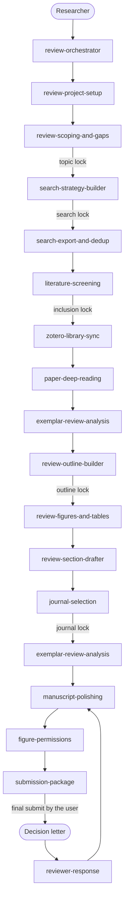

[中文](README.zh.md) / [English](README.md)

# literature-review-skills

这是一个不依赖特定 agent 的技能套件，能够带领研究人员从模糊的主题一直走到综述初稿乃至返修，确保每一个论点都与项目中实际持有的文献来源相绑定。这些技能内置了公共报告规范（PRISMA 2020、PRISMA-S、Cochrane 手册第4章、JBI 范围指南、ICMJE、COPE）以及 PubMed、Web of Science、Scopus、Zotero、Unpaywall、Crossref 和 RightsLink 的官方工作流。该 agent 会在人工节点停下，并且绝不编造引用。

本套件专为撰写叙述性、系统性、范围或伞形综述的研究人员设计，满足他们对可重复的文件夹结构，以及一个绝不跳过纳排标准、检索报告或权限申请的 agent 的需求。

## 功能

- 17项技能，涵盖从项目建立到针对审稿意见逐条回复的全过程。`review-orchestrator` 会读取 `project.yaml` 并路由到下一个技能。
- 6个人工节点：主题、检索式、纳入标准、大纲、期刊和最终提交。用户通过节点，agent 会将其记录下来。
- 建立证据表。草稿中的句子会映射到证据 ID，否则保留 `[NEEDS SOURCE]` 标记。
- 经过测试的去重器（依次检查 `DOI`、`PMID` 以及标准化的标题和年份），从 RIS、PubMed NBIB 和 CSV 导出文件中记录 PRISMA 识别数量统计。
- 默认生成原创图表，绘制为可编辑的 SVG 以及 PDF 文件。重复使用或改编的图表会被登记以申请权限，而非直接复制或裁剪。
- 叙述性综述可以保留用户确认的核心文献，并将其余文献记录为未阅读。系统性、范围和伞形综述仍会筛选每一条去重后的记录。
- 综述大纲将局限性和下一步研究问题作为独立的章节。锁定期刊后，会更新样式简报，润色步骤将遵循该期刊的标题模式、摘要形状和图表预算。
- 项目文件、模板和 agent 生成的输出均为英文。

## 工作流

文件夹编号是存储位。下方的顺序即代表工作的顺序。锁定期刊发生在润色之前，以便稿件能够遵循该期刊的格式要求。一旦图表登记表中出现改编或重复使用的条目，就可以启动 `figure-permissions` 技能；只有在这些条目结清后，才能进行最终提交。



## 技能

| # | 技能 | 用途 |
|---|-------|---------|
| 0 | `review-orchestrator` | 入口点。读取 `project.yaml` 和 `LOG.md`，报告当前阶段，路由到下一个技能，并强制执行人工节点拦截。 |
| 1 | `review-project-setup` | 创建目录结构，向用户提问（主题、领域、综述类型、目标读者、时间表），并写入 `project.yaml`。 |
| 2 | `review-scoping-and-gaps` | 执行背景扫描，列出候选角度、知识空白说明、可行性统计，并推荐一个角度。人工节点：锁定主题。导出后可选的聚类步骤可能会要求重新开启该节点。 |
| 3 | `search-strategy-builder` | 将 PICO、PEO 或 SPIDER 概念转化为同义词、MeSH 或 Emtree 词表及字段标签；生成 PubMed、Web of Science 和 Scopus 的检索式；测试运行数量统计；PRISMA-S 报告块。人工节点：锁定检索式。当命中数量极端时，可选用宽泛、适中和严格的检索式；锁定其中一个检索式。 |
| 4 | `search-export-and-dedup` | 导出检索结果（如果用户在浏览器中操作则导出浏览器结果，否则导出 RIS、NBIB 或 CSV），合并并去重，写入 PRISMA 识别数量统计。 |
| 5 | `literature-screening` | 执行纳入和排除标准，进行标题/摘要和全文筛选并附带原因，可选 Cohen's kappa，以及提供 PRISMA 2020 流程数据。叙述性综述则保留用户确认的核心文献，并将其余文献记录为未阅读。 |
| 6 | `zotero-library-sync` | 将纳入的记录导入 Zotero，映射分类目录，并记录合法的全文获取路径。用户确认集合检查清单。不使用影子图书馆，不控制桌面。仅在用户要求后才进行可选的笔记导出。 |
| 7 | `paper-deep-reading` | 撰写单篇文献笔记和证据表行数据。仅使用附带页码的简短原文引用。 |
| 8 | `exemplar-review-analysis` | 阅读 3-5 篇用户可以打开的近期综述并撰写样式简报。锁定期刊后，根据锁定期刊的综述更新该简报。 |
| 9 | `review-outline-builder` | 创建主题大纲，包含各节论点、证据 ID、计划图表和字数预算，包括局限性和下一步研究问题。系统性综述还会获得注册提醒和偏倚工具检查清单。人工节点：锁定大纲。 |
| 10 | `review-figures-and-tables` | 规划原创的图1论证导图、综合表格及图表登记表。为每个原创条目生成 SVG 和 PDF 文件。 |
| 11 | `review-section-drafter` | 根据大纲和证据表一次起草一节，使用与证据匹配的严谨措辞。完成的草稿必须包括局限性和下一步研究问题。 |
| 12 | `journal-selection` | 基于官方页面信息（收录范围、综述文章类型、邀请规则、OA及版面费、审稿周期、数据库收录情况）筛选 3-5 本候选期刊并推荐一本。分区或引用指标仅在当天打开的官方页面中记录。人工节点：锁定期刊。 |
| 13 | `manuscript-polishing` | 根据更新后的样式简报和期刊格式要求调整草稿，编辑语言，并根据证据表核对论点。不提出新的主张。 |
| 14 | `figure-permissions` | 为每张重复使用或改编的图表记录许可证、RightsLink 或出版商许可申请、署名要求和残余风险。 |
| 15 | `submission-package` | 投稿信（markdown 和 docx 格式）、引用自作者页面的领域指南、标题页、声明文件、带利益冲突检查的推荐审稿人，以及上传检查清单。重点（Highlights）和作为原创图像的视觉摘要仅在该页面要求时起草。 |
| 16 | `reviewer-response` | 为每条审稿意见编号，并逐条起草回复，在回复中仅引用实际做出的修改。 |

## 安装

`install.sh` 脚本会链接（默认）或复制包含 `SKILL.md` 文件的每个 `skills/<name>` 目录。

| Tool | Destination |
|------|-------------|
| Cursor | `~/.cursor/skills/<name>` |
| Claude Code | `~/.claude/skills/<name>` |
| Codex | `~/.codex/skills/<name>` |

```bash
bash install.sh --target cursor --mode link
bash install.sh --target claude --mode copy
bash install.sh --target codex
bash install.sh --target all --dry-run
bash install.sh -h
```

`--target` 参数可指定为 `cursor`、`claude`、`codex` 或 `all`（默认为 `all`）。`--mode` 参数可指定为 `link`（默认）或 `copy`。`--dry-run` 标志仅打印执行计划而不写入文件。第二次 link 安装会保持正确的符号链接不变。请开启新会话以重新加载技能。路径支持 `$HOME`。

运行本仓库的测试：

```bash
python3 -m pytest
```

## 快速开始

输入：`start a new review on drought responses in grapevine`。

这将触发 `review-project-setup`。当 `project.yaml` 生成后，输入 `what is the next step` 来调用 `review-orchestrator`。

## 项目文件夹

`review-project-setup` 会创建：

```text
<project>/
  project.yaml
  LOG.md
  00-scope/
  01-search/
  02-records/
  03-screening/
  04-library/
  05-reading/
  evidence/evidence_table.csv
  06-exemplars/
  07-outline/
  08-figures/
  09-draft/
  10-polish/
  11-journal/
  12-permissions/
  13-submission/
  14-revision/
```

`evidence/evidence_table.csv` 会在首次深度阅读时依据 `shared/evidence_table_schema.md` 创建。人工节点的定义位于 `shared/gates.md`，句子级别的规则位于 `shared/writing_rules.md`。

## 原则

1. 每一个陈述事实的句子都必须映射到 `evidence/evidence_table.csv`，否则标记为 `[NEEDS SOURCE]`。
2. 未知的标识符和数据会标记为 `[VERIFY]`。Agent 不会编造 DOI、PMID、作者、年份、期刊名称或统计数据。
3. Agent 会在 6 个人工节点停下。数据库登录、支付、版权转让和期刊系统的 Submit 按钮操作均保留由用户完成。
4. 影响因子、版面费（APC）、字数限制和收录范围均从期刊官方页面复制并记录日期。
5. 图表默认生成原创的 SVG 和 PDF 文件，除非图表登记表中明确标记为改编或重复使用，在这种情况下，`figure-permissions` 将在提交前运行。已发表的图表绝不会被裁剪处理。
6. 使用单一项目文件夹。每个技能读取之前文件夹的数据，并输出自己的结果文件。
7. 所有的决定都追加到 `LOG.md` 中且不被删除。当使用决策卡片时，它不能替代是或否的人工锁定。

## 免责声明

本套件不能替代作者对综述内容的责任，作者必须亲自检查每一处引用和数字，或遵守数据库条款和出版商协议。该套件不会代为提交稿件、支付版面费、转让版权或登录数据库。通过 `final_submit` 仅记录用户判断文件包已准备好供其亲自上传。AI 工具不具备作者资格（ICMJE: https://www.icmje.org/recommendations/）。

## 许可证

MIT. Copyright (c) 2026 Xuzhen Li. See [LICENSE](LICENSE).
