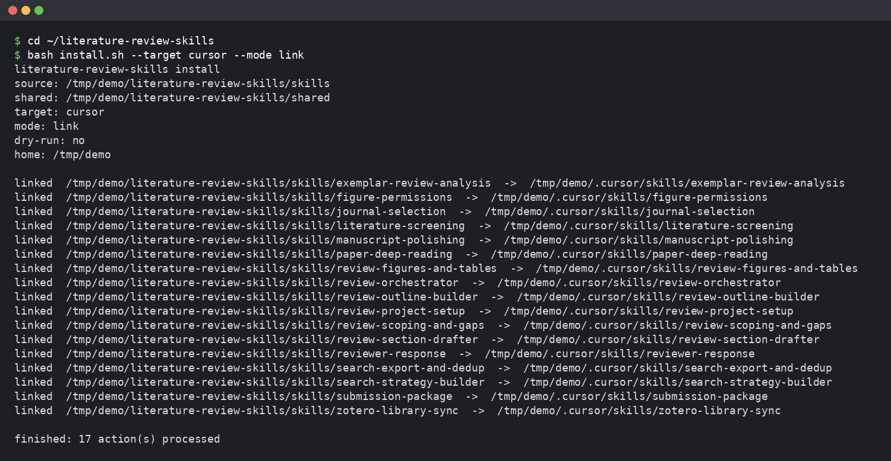
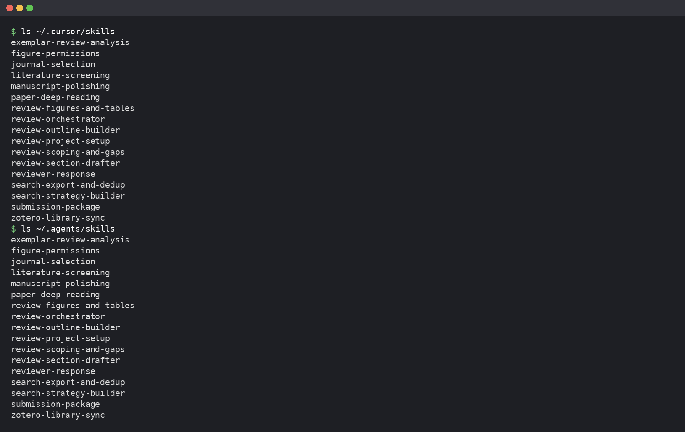
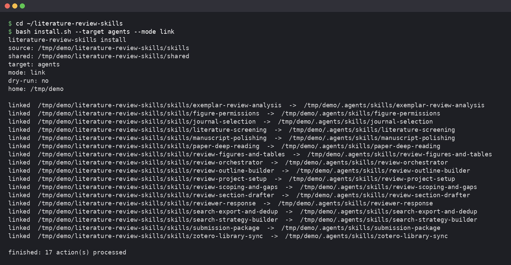
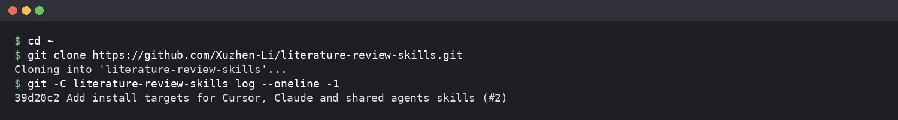
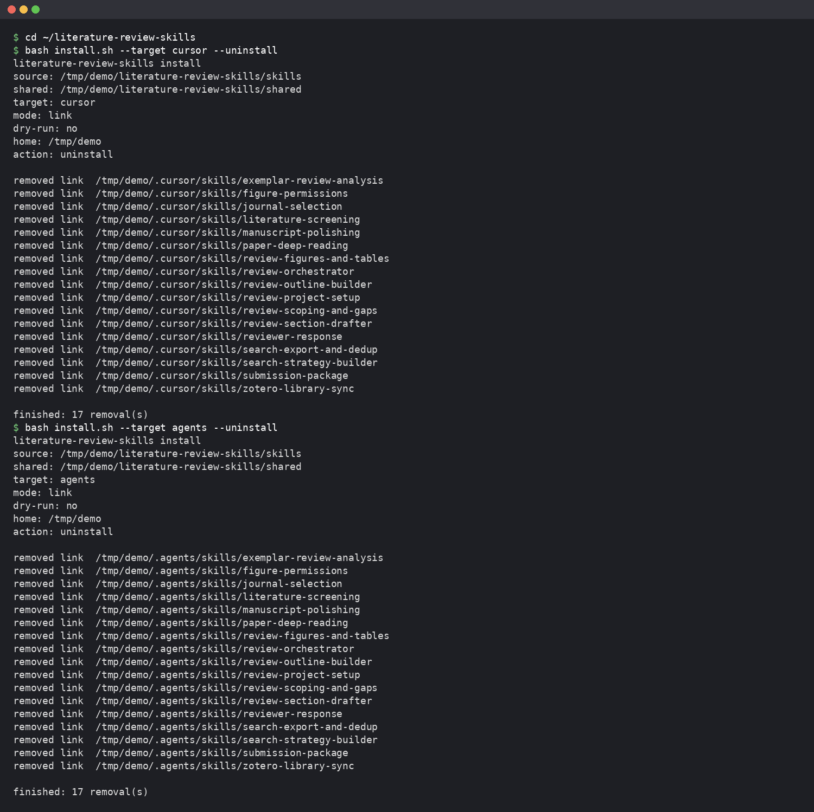
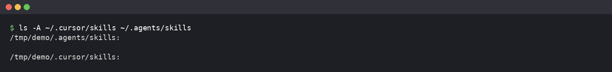

# Getting started with literature-review-skills for beginners
One instruction pack per review stage, so the AI assistant walks you from topic to submission, stops at human gates and never invents citations. See the Skills table for all 17 skills.

## 1. Using it in Cursor

First, download and install Cursor itself (to verify). Open a terminal, which is a text interface where you type commands to operate your computer. Run the following command to download this repository:

```bash
git clone https://github.com/Xuzhen-Li/literature-review-skills
```
Go into the cloned folder and run the installation script:

```bash
bash install.sh --target cursor
```
This installs the files to `~/.cursor/skills/<name>`. Start a new session so Cursor reloads the skills (whether Cursor shows a loaded indicator is to verify). With the repository folder open in Cursor, `.cursor/rules/literature-review.mdc` helps with routing using its `alwaysApply: false` setting.

Other ways: Route B, local plugins must be cloned or copied directly to `$HOME/.cursor/plugins/local/literature-review-skills` because symlinks are not allowed there. `--target agents` installs to `~/.agents/skills`, which Codex reads. `--target all` installs cursor, claude and agents. Add `--dry-run` to show the plan and write nothing.

[[TODO-TEXT: English counterpart of the Chinese line "Cursor 路线不需要 bundle（打包好的单一文件）文件。"]]

Type this in the chat to begin:

```
start a new review on drought responses in grapevine
```
[screenshot to add] cursor-new-chat

A successful terminal installation shows 17 `linked … -> …` lines and ends with `finished: 17 action(s) processed`.

Running `ls ~/.cursor/skills` lists the 17 installed skill folders (shown in the top half of the screenshot).

If agents was installed too: 

In chat, the assistant gives its opening line, then opens the database homepage.
[screenshot to add] cursor-first-reply

## 2. Using it in ChatGPT

You must first install Python (to verify). Open your terminal in the repository root and generate the bundle, which is a single package containing all required instructions and files for chat platforms:

```bash
python3 scripts/bundle.py
```
This creates the `dist/` folder, which is not in the repository and must be generated [pending decision]. A successful build ends with `knowledge files: 18 (max 20)`.
[screenshot to add] chatgpt-bundle-terminal

Open ChatGPT and create or edit a custom GPT (button location to verify). Paste all of `dist/chatgpt/instructions.md` into the Instructions box.
[screenshot to add] chatgpt-gpt-instructions

Upload all 18 files from `dist/chatgpt/knowledge/` as Knowledge. Limits are 8,000 characters for instructions and 20 knowledge files.
[screenshot to add] chatgpt-dist-folder
[screenshot to add] chatgpt-gpt-knowledge

In chat, the GPT asks you to paste or attach `project.yaml` and `LOG.md`, or routes to project setup if they do not exist. Custom GPTs are being retired, with Enterprise retirement planned for 2026-12-11. Chat cannot run scripts.
[screenshot to add] chatgpt-first-reply

## 3. Using it in DeepSeek

Build the files the same way as section 2 to get `dist/deepseek/literature-review-skills.md`. Open the DeepSeek chat page and start a new chat (URL and buttons to verify). Paste the whole file as the first message, or attach it. We cannot promise whether the web version keeps a system prompt or what its upload limit is. API users can put the file in the system message.
[screenshot to add] deepseek-attach

After your question, the assistant judges the stage and asks for `project.yaml` and `LOG.md` when needed.
[screenshot to add] deepseek-first-reply

## 4. Opening a terminal

On macOS, open Applications, then Utilities, then Terminal. On Windows, use Git Bash if Git for Windows is installed, or PowerShell only if `bash` is already on PATH [pending decision]. Run commands inside the cloned folder. Use `cd` to change directories.

```bash
cd ~
```
```bash
git clone https://github.com/Xuzhen-Li/literature-review-skills
```

[screenshot to add] terminal-open-mac
[screenshot to add] terminal-open-windows

## 5. Minimal example

Start by typing this first message:

```
start a new review on drought responses in grapevine
```
This triggers `review-project-setup`. The assistant gives a fixed opening line. It opens the Web of Science homepage and lets you sign in, but it never types your password. How the "open the homepage" step works in chat is to verify. You hit a gate, which is a built-in pause where the AI waits for your explicit approval before continuing. You must reply with one exact line, and simple words like "yes" or "ok" do not count:

```
I have confirmed institutional login
```
Or:

```
I have no download permission on this computer
```
It asks in one message for the title, field, review type, audience, timeline, target journal, whether PubMed will be searched, and the project folder path. Then it creates the folders, `project.yaml` and `LOG.md`.
[screenshot to add] example-project-yaml

Next message:

```
what is the next step
```
The `review-orchestrator` reports the stage.
[screenshot to add] example-next-step

There are seven human gates in total. Each one passes only with a fixed sentence, for example:

```
I confirm the topic lock
```
On ChatGPT or DeepSeek, you keep `project.yaml` and `LOG.md` yourself and paste them back next time.

## 6. FAQ

What is the difference between a skill and a plugin? Which should I use?
The skills folder is the main path (Route A); a local plugin is Route B.

I have no programming experience. Do I have to use a terminal?
Yes, you need a terminal to clone the repository and run the installation.

`bash install.sh` says `exists and is not a symlink`. What do I do?
Symlinks are not allowed there; clone or copy directly.

I installed it, but the assistant does not seem to use the skills. Why?
Start a new session so the platform reloads the skills.

Where is the `dist/` folder? Why is it not in the download?
It is not in the repository and must be generated locally.

ChatGPT says the instructions are too long or there are too many files. What now?
Upload all 18 files from `dist/chatgpt/knowledge/`. The limits are 8,000 characters for instructions and 20 knowledge files.

Will this still work after custom GPTs are retired?
Custom GPTs are being retired, with Enterprise retirement planned for 2026-12-11.

How large a file can I upload to DeepSeek on the web?
The upload limit is unverified.

Can the chat run the deduplication script?
No, chat platforms cannot run scripts.

Will the assistant invent references for me? Will it submit for me?
No, it never invents citations and stops at human gates.

What is a human gate, and why must I reply with a fixed sentence?
It is a stopping point requiring a fixed sentence because simple words like "yes" or "ok" do not count.

If I open a new chat, do I lose my progress?
Keep `project.yaml` and `LOG.md` yourself and paste them back next time.

Does it work on Windows? [pending decision]
Use Git Bash if Git for Windows is installed, or PowerShell only if `bash` is already on PATH. If `python3` is not found, try `python` or `py` instead.

How do I update to a new version?
Steps are currently unverified.

How do I uninstall?
Run `bash install.sh --target cursor --uninstall`. Delete the old `~/.codex/skills` by hand.


